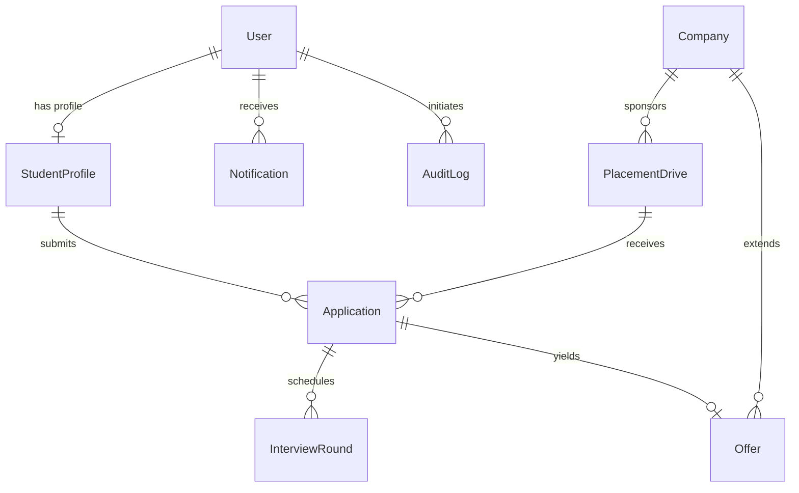

# PlaceTrack — College Placement Management System
## System Architecture & Technical Specification

### 1. System Overview
PlaceTrack is a full-stack academic placement management platform built with React (Vite) and Node.js/Express with MongoDB. It automates the end-to-end placement pipeline for colleges, providing tailored dashboards and workflows for **Admin**, **Training & Placement Officer (TPO)**, and **Students**.

```
+-----------------------------------------------------------------------+
|                           CLIENT (React + Vite)                       |
|  - Tailwind CSS + Lucide Icons + Recharts + React Hook Form           |
|  - Auth Context + Role-based Route Protection                         |
|  - Responsive Dark Navy / Clean Modern Academic UI                   |
+-----------------------------------------------------------------------+
                                  |
                              REST APIs
                             (Axios + JWT)
                                  v
+-----------------------------------------------------------------------+
|                       SERVER (Node.js + Express)                      |
|  - ES Modules ("type": "module")                                      |
|  - Middleware: JWT Auth, Role Guard, Rate Limit, Helmet, CORS         |
|  - Centralized Deterministic Eligibility Engine                       |
|  - Auditing & Notification Dispatcher                                 |
+-----------------------------------------------------------------------+
                                  |
                             Mongoose ODM
                                  v
+-----------------------------------------------------------------------+
|                            DATABASE (MongoDB)                         |
|  - Collections: Users, StudentProfiles, Companies, PlacementDrives,   |
|    Applications, InterviewRounds, Offers, Notifications, AuditLogs    |
|  - Compound Indexes (e.g., student + drive unique constraint)        |
+-----------------------------------------------------------------------+
```

### 2. Database Models & Schema Relationships



1. **User**: Credentials, role (`admin`, `tpo`, `student`), department, status.
2. **StudentProfile**: PRN, CGPA, backlogs, technical skills, resume URL, graduation year.
3. **Company**: Corporate details, HR contact, description, active status.
4. **PlacementDrive**: Eligibility thresholds (min CGPA, max backlogs, eligible departments, batch years), deadlines, salary package, status (`Draft`, `Published`, `Closed`, `Cancelled`).
5. **Application**: Compound unique index `(student, drive)`, status workflow (`Applied`, `Shortlisted`, `In Process`, `Selected`, `Rejected`, `Withdrawn`), status history audit.
6. **InterviewRound**: Round sequence, round type (`Aptitude`, `Technical`, `Managerial`, `HR`, `Final Decision`), schedules, results, interviewer feedback.
7. **Offer**: Role, CTC/LPA, response deadline, status (`Pending`, `Accepted`, `Declined`).
8. **Notification**: User-specific real-time in-app alerts for status updates, new drives, and interviews.
9. **AuditLog**: Traceability for critical administrative actions (status changes, drive publishing, account adjustments).

### 3. Centralized Eligibility Engine Rules
The eligibility engine executes deterministically on the backend (`eligibilityService.js`):
1. **Drive State**: `drive.status === 'Published'`
2. **Deadline**: `new Date() <= drive.applicationDeadline`
3. **Academic Merit**: `student.cgpa >= drive.minCgpa`
4. **Academic Standing**: `student.activeBacklogs <= drive.maxBacklogs`
5. **Department Match**: `drive.eligibleDepartments.includes(student.department)`
6. **Graduation Batch**: `drive.graduationYears.includes(student.graduationYear)`
Returns: `{ isEligible: boolean, reasons: string[] }`.

### 4. Implementation Plan (10 Phases)
- **Phase 1**: Requirements verification & System Architecture.
- **Phase 2**: Project scaffolding (Client Vite React + Server Express ES modules) & Mongoose models.
- **Phase 3**: Authentication & Role-based Authorization (JWT, bcryptjs, role guards).
- **Phase 4**: Student & Company CRUD Management with validation & pagination.
- **Phase 5**: Placement Drive Management & Centralized Eligibility Engine.
- **Phase 6**: Application Pipeline & Interview Management workflows.
- **Phase 7**: Offer tracking, In-App Notifications & Aggregated Placement Analytics.
- **Phase 8**: Rich Frontend Dashboard & Role-specific Views.
- **Phase 9**: Automated Backend Tests (Supertest) & Manual Verification.
- **Phase 10**: Seed Script, Comprehensive Documentation & Academic Artifacts.
